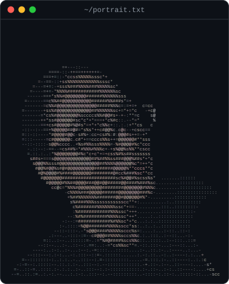

<h3><code>thaynarlt@github ~ $ ./contributions.sh</code></h3>

  

<h3><code>thaynarlt@github ~ $ whoami</code></h3>

<table>
  <tr>
    <td valign="top"></td>
    <td valign="top"></td>
  </tr>
</table>

 

<h3><code>thaynarlt@github ~ $ cat sobre-mim.md</code></h3>

Profissional multidisciplinar unindo **design**, **desenvolvimento front-end** e **cibersegurança**. 
Atuo na criação de interfaces centradas no usuário, na implementação dessas interfaces em código 
e na produção de conteúdo audiovisual.

🎨 Design de produto e identidade visual (UX/UI e Graphic Design) 
💻 Desenvolvimento front-end com foco em interfaces acessíveis e responsivas 
🔐 Estudos e práticas em cibersegurança 
🎬 Edição e produção de vídeo 
🌱 Atualmente aprofundando em React, Node.js e Tailwind

 

<h3><code>thaynarlt@github ~ $ ls ~/stack</code></h3>

 

<h3><code>thaynarlt@github ~ $ ls ~/projetos</code></h3>

| Projeto | Descrição | Stack |
|---------|-----------|-------|
| [series.app](https://thaynatolentino.vercel.app/projetos/series-app-catalogo) | App para acompanhar e organizar as séries que você assiste, com conta pessoal e login. | Next.js, React, TypeScript, Autenticação |
| [Financeiro](https://thaynatolentino.vercel.app/projetos/financas-controle-financeiro) | Aplicação web para organizar receitas e despesas e acompanhar o saldo, com cadastro e área restrita por usuário. | Next.js, React, TypeScript, Autenticação |

 

<h3><code>thaynarlt@github ~ $ ./links.sh</code></h3>

 

